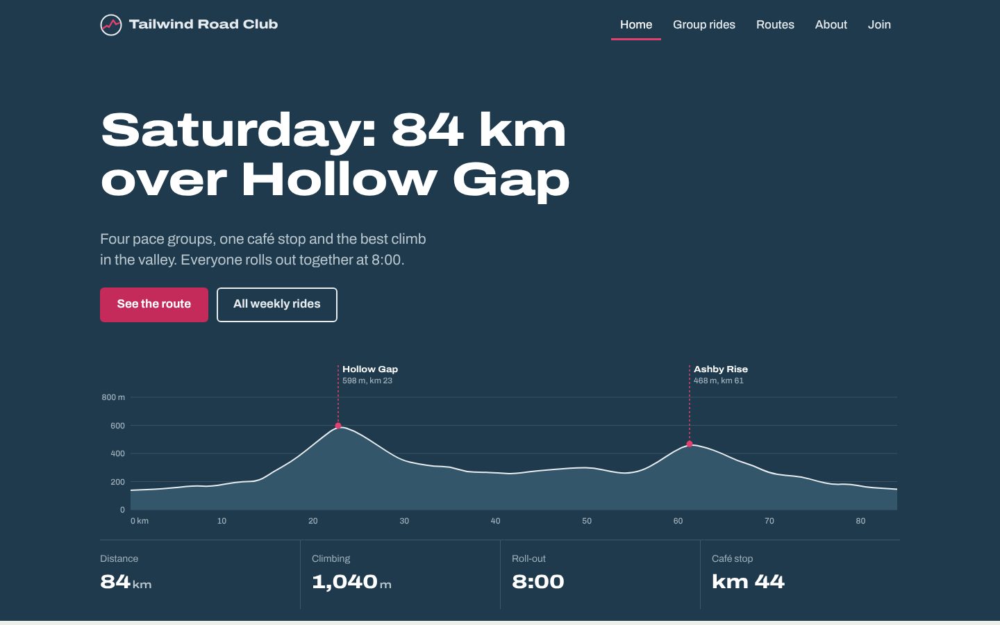
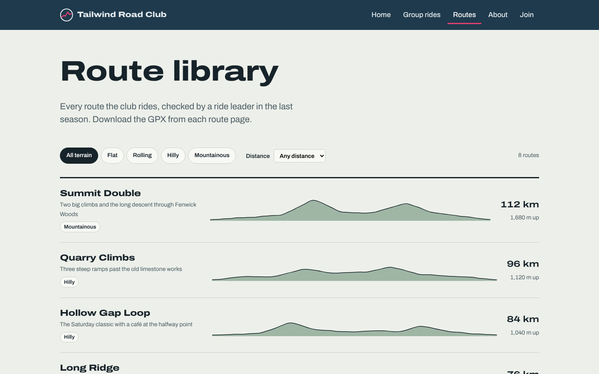
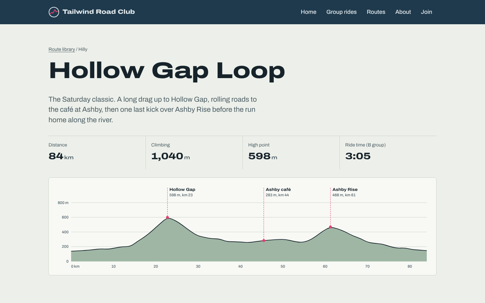
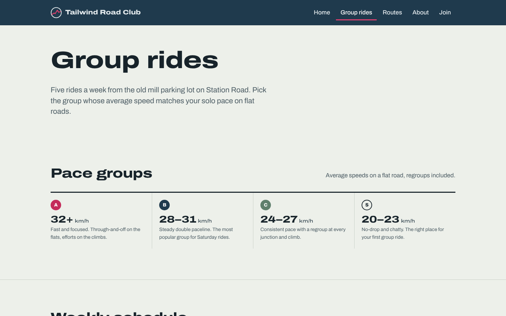
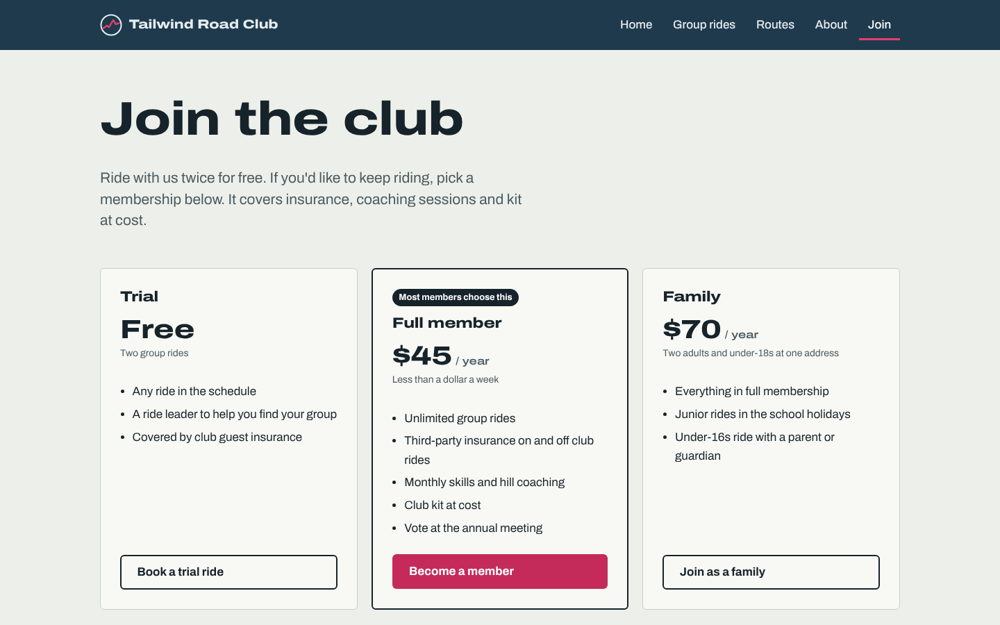
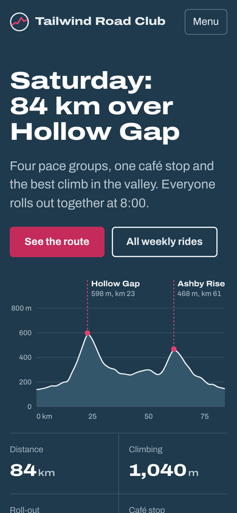

# Tailwind: Road Cycling Website Template

A free, six-page website template for road cycling clubs, group rides, coaches and bike shops that run club rides. It's built with plain HTML, CSS and a little vanilla JavaScript, so there are no frameworks, no build step and nothing to install.

Its main feature is a set of **stage-style elevation profiles**, like the route charts in a race road book. They're drawn from a simple list of numbers, so you can add your own routes without opening a design tool.

**[Live demo](https://YOUR-USERNAME.github.io/road-cycling/)** · **[Download on templategalaxy](https://templategalaxy.sbs)**



## Pages

| Page | File | What's on it |
|------|------|--------------|
| Home | `index.html` | Featured ride with an animated elevation profile, this week's rides, popular routes, sign-up banner |
| Group rides | `rides.html` | Pace groups, weekly ride schedule, group riding basics, what to bring, meeting point |
| Route library | `routes.html` | Eight routes with small elevation profiles, filtered by terrain and distance |
| Route detail | `route.html` | Route stats, profile with climb markers, climb list, turn-by-turn directions, GPX download |
| About | `about.html` | Club history timeline, ride leaders, club kit |
| Join | `join.html` | Membership options, sign-up form with validation, FAQ |

<table>
  <tr>
    <td></td>
    <td></td>
  </tr>
  <tr>
    <td></td>
    <td></td>
  </tr>
</table>

<p align="center"></p>

## Features

- Six pages that work from 320px phones up to wide desktop screens
- Elevation profiles drawn from data, with climb markers and axes
- Route library filtered by terrain and distance, with no page reload
- Ride schedule laid out as an accessible table that turns into a stacked list on phones
- Sign-up form with inline error messages, ready to connect to Formspree, Netlify Forms or any other form service
- Every color, font size and layout width set as a CSS variable in one place
- Accessibility basics included: skip link, visible keyboard focus, labelled fields, reduced-motion support, and text alternatives for every profile
- No dependencies apart from the Archivo font from Google Fonts

## Quick start

1. [Download the ZIP](https://github.com/YOUR-USERNAME/road-cycling/archive/refs/heads/main.zip) or clone the repository:
   ```bash
   git clone https://github.com/YOUR-USERNAME/road-cycling.git
   ```
2. Open `index.html` in your browser. That's it, there's nothing to build.
3. Edit the content, swap in your own photos, and upload the folder to any web host.

### Publish free with GitHub Pages

In your repository on GitHub, go to **Settings → Pages**. Under **Source**, choose **Deploy from a branch**, pick `main` and `/ (root)`, then click **Save**. The site will be live at `https://YOUR-USERNAME.github.io/road-cycling/` within a minute or two.

## File structure

```
road-cycling/
├── index.html        Home
├── rides.html        Group rides and pace groups
├── routes.html       Route library
├── route.html        Route detail
├── about.html        About the club
├── join.html         Membership and sign-up
├── css/style.css     All styles and design tokens
├── js/main.js        Profiles, filters, mobile menu, form
├── images/           Favicon and your photos
└── screenshots/      README images (safe to delete)
```

## Customizing

### Colors and type

All the design tokens are at the top of `css/style.css`:

```css
:root {
  --bg: #edf0ea;            /* page background */
  --ink: #17232a;           /* body text */
  --road: #1f3a4d;          /* header, hero and footer */
  --terrain: #9fb6a5;       /* elevation profile fill */
  --accent: #e2406f;        /* climb markers, highlights */
  --accent-strong: #c42b5a; /* buttons */
  /* ... */
}
```

### Elevation profiles

Each profile is an `<svg>` element with data attributes, and `js/main.js` draws it:

```html
<svg class="profile"
     data-km="84"
     data-elev="138,143,149,159,171,165,184,201"
     data-climbs="Hollow Gap@23;Ashby Rise@61"
     role="img" aria-label="Elevation profile for the Hollow Gap Loop"></svg>
```

| Attribute | Required | What it does |
|-----------|----------|--------------|
| `data-km` | Yes | Total distance of the route |
| `data-elev` | Yes | Elevations in metres, evenly spaced along the route. 40 to 80 values works well |
| `data-climbs` | No | Climb markers written as `Name@km`, separated by semicolons |
| `data-height` | No | Height in pixels (220 by default) |
| `data-axis="none"` | No | A compact profile without axes, used in route lists |
| `data-draw` | No | Draws the line on page load. It's skipped for visitors who prefer reduced motion |

You can get elevation data by exporting a GPX file from Strava, RideWithGPS or Komoot and taking the `<ele>` values at regular intervals.

### Photos

Every `<figure class="photo">` is a placeholder. Add your image inside it and delete the caption:

```html
<figure class="photo">
  
</figure>
```

### Route filters

Each route in `routes.html` has `data-km` and `data-terrain` attributes. The terrain value can be `flat`, `rolling`, `hilly` or `mountain`.

### Sign-up form

Until you give the form an `action`, it shows a sample confirmation instead of sending anything. To receive sign-ups, add your form service's endpoint:

```html
<form class="form" data-join-form action="https://formspree.io/f/your-id" method="POST" novalidate>
```

### Navigation

The header and footer are repeated in each page, so change all six files when you add or rename a link.

### Units

The demo copy uses kilometres, metres and US dollars. To use miles and feet, change the text and the axis labels in `renderProfile()` in `js/main.js`.

## Browser support

The template works in current versions of Chrome, Edge, Firefox and Safari, on both desktop and mobile.

## Credits

- Typeface: [Archivo](https://fonts.google.com/specimen/Archivo) by Omnibus-Type, under the SIL Open Font License
- All club names, people, routes and places in the demo content are fictional

## License

Released under the [MIT License](LICENSE). You can use it for personal and commercial projects, change it, and share it. Please keep the license file with the code.

---

More free templates are on **[templategalaxy](https://templategalaxy.sbs)**.
